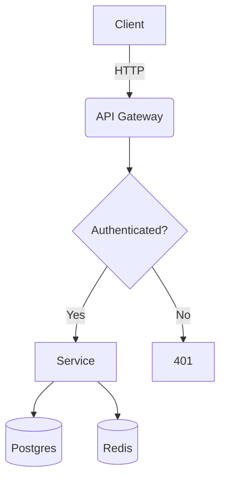
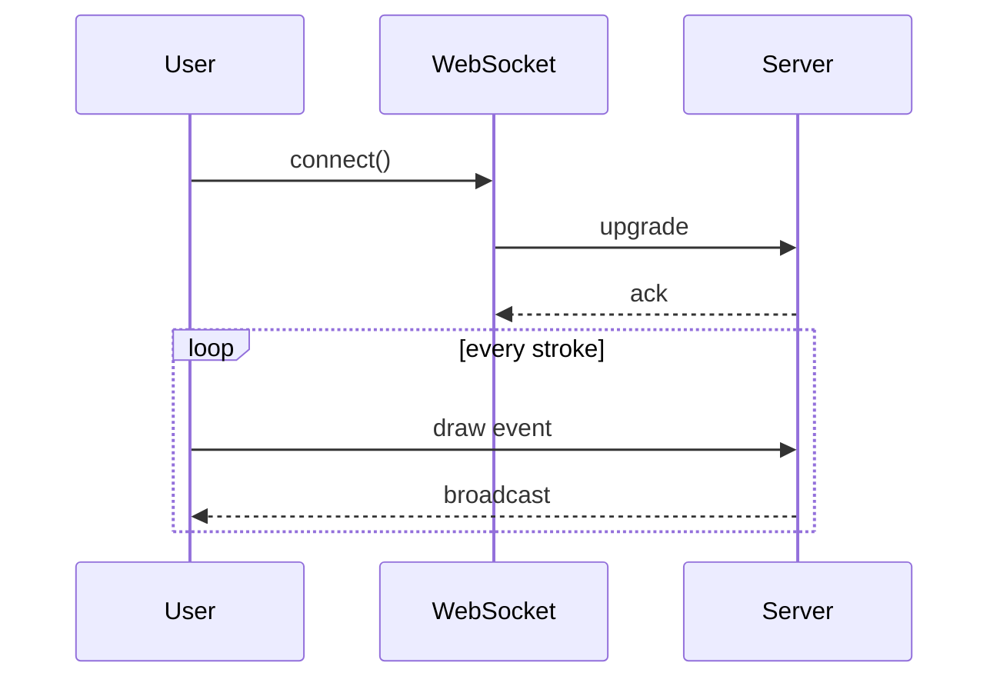

export const metadata = {
    title: 'Transformers',
    uri:  'transformer',
    description: 'Here we will explain the transformer architecture model in a simplified and easy manner',
    estimated: "30 mins",
    date: new Date(2004, 10, 12),
}

# H1 — Markdown Editor Torture Test

A single paragraph immediately after the H1 to check heading/paragraph spacing.
This sentence is on a second source line with no trailing spaces, so it should
**join** the previous line in the rendered output.

This line ends with two trailing spaces,  
so this should be a hard line break (`<br>`), not a new paragraph.

This one uses a backslash at the end\
to force a hard break as well.

## H2 — Inline formatting

**Bold**, *italic*, ***bold italic***, _underscore italic_, __underscore bold__,
~~strikethrough~~, `inline code`, ``code with a ` backtick inside``, and
<mark>highlighted via raw HTML</mark>.

Nested combos: **bold with `code` and *italic* inside**, and `**literal asterisks in code**`.

Subscript H<sub>2</sub>O, superscript E = mc<sup>2</sup>, <kbd>Ctrl</kbd> + <kbd>C</kbd>.

Escapes: \*not italic\*, \_not italic\_, \# not a heading, \`not code\`, 100\% sure,
a literal backslash \\ and a pipe \| outside a table.

Ambiguous emphasis: snake_case_identifier should NOT become italic. Neither should
a*b*c in most parsers — but it often does. intra**word**bold is another classic.

### H3 — Links

- Inline: [SparkLayer](https://www.sparklayer.io)
- Inline with title: [CommonMark spec](https://spec.commonmark.org/ "The spec")
- Reference: [reference-style link][ref]
- Collapsed reference: [ref][]
- Shortcut reference: [ref]
- Autolink: https://example.com/some/path?query=1&other=2
- Bare URL (GFM autolink): https://example.com/bare
- Email: hello@example.com
- Anchor to a heading: [jump to tables](#h2--tables)
- Relative file link: [./README.md](./README.md)
- Link with parens in URL: [wiki](https://en.wikipedia.org/wiki/Markdown_(disambiguation))
- Footnote reference[^1] and a second one[^long-note].

[ref]: https://daringfireball.net/projects/markdown/ "Original Markdown"

#### H4 — Images

Inline image:


Small inline image in a sentence:  — should sit on the text baseline.

Image with title attribute:


Linked image (image wrapped in a link):

[](https://example.com)

Reference-style image:

![Reference image][img-ref]

[img-ref]: https://picsum.photos/seed/reference/640/240 "Reference-style image"

Broken image (tests your alt-text / error fallback):


Relative path image (tests base-path resolution):


Raw HTML image with explicit sizing:


##### H5 — Lists

Unordered, tight:

- Item one
- Item two
- Item three

Unordered, loose (blank lines between items):

- Item one

- Item two

- Item three

Mixed markers and deep nesting:

- Level 1 (dash)
  * Level 2 (asterisk)
    + Level 3 (plus)
      - Level 4
        - Level 5 — check the indent guides and bullet glyph cycling
- Back to level 1

Ordered lists:

1. First
2. Second
3. Third

Ordered list with a non-1 start:

5. Five
6. Six
7. Seven

Lazy numbering (all `1.`) — should still render 1, 2, 3:

1. Alpha
1. Beta
1. Gamma

Mixed nesting with content blocks inside items:

1. Ordered parent

   A paragraph inside the list item. It needs three-space indentation to stay
   attached to the item above.

   ```bash
   echo "a fenced code block inside a list item"
   ```

   - Nested bullet
   - Another nested bullet

     > A blockquote nested inside a nested list item.

2. Second ordered item

Task lists (GFM):

- [x] Completed task
- [ ] Incomplete task
- [x] ~~Completed and struck through~~
- [ ] Task with `code`, a [link](https://example.com), and **bold**
  - [ ] Nested subtask
    - [x] Deeply nested done subtask

Definition list (not CommonMark — many editors need an extension):

Term 1
: Definition of term 1

Term 2
: Definition of term 2
: A second definition of term 2

###### H6 — Smallest heading

Alternate (setext) heading syntax
=================================

Setext H2
---------

## H2 — Blockquotes

> A simple blockquote.

> A multi-paragraph blockquote.
>
> Second paragraph, still quoted.
>
> - With a list
> - Inside the quote
>
> ```python
> print("and a code block inside a quote")
> ```

> Nested quotes:
>
> > Level two.
> >
> > > Level three. How far does the styling hold up?

Lazy continuation — this line has no `>` marker but belongs to the quote:

> First line of the quote
continues here without a marker.


## H2 — Code

Inline: install with `npm i -D @types/node`, run `go test ./... -race`, check `$HOME/.config`.

Fenced, no language (plain preformatted):

```
plain text block
  preserving    whitespace
	and a literal tab character
```

JavaScript / TypeScript:

```typescript
// Comment: single-line
/* Comment: block */
/**
 * JSDoc comment — checks doc-comment highlighting.
 * @param items - the things to reduce
 */
interface CartLine {
  sku: string;
  qty: number;
  unitPrice: number; // minor units
}

export const subtotal = (lines: readonly CartLine[]): number =>
  lines.reduce((acc, { qty, unitPrice }) => acc + qty * unitPrice, 0);

async function main(): Promise<void> {
  const res = await fetch(`https://api.example.com/cart?id=${encodeURIComponent("abc")}`);
  if (!res.ok) throw new Error(`HTTP ${res.status}`);
  const lines = (await res.json()) as CartLine[];
  console.log(`Total: £${(subtotal(lines) / 100).toFixed(2)}`);
}

main().catch((e) => {
  console.error(e);
  process.exit(1);
});
```

Go:

```go
package main

import (
	"context"
	"errors"
	"fmt"
	"time"
)

// Worker consumes jobs until the context is cancelled.
type Worker struct {
	ID    int
	Queue <-chan string
}

var ErrShutdown = errors.New("worker: shutting down")

func (w *Worker) Run(ctx context.Context) error {
	for {
		select {
		case <-ctx.Done():
			return fmt.Errorf("worker %d: %w", w.ID, ErrShutdown)
		case job, ok := <-w.Queue:
			if !ok {
				return nil
			}
			time.Sleep(10 * time.Millisecond) // simulate work
			fmt.Printf("worker %d handled %q\n", w.ID, job)
		}
	}
}
```

PHP:

```php
<?php

declare(strict_types=1);

namespace App\Services;

use Illuminate\Support\Collection;

final class PriceCalculator
{
    public function __construct(
        private readonly float $vatRate = 0.20,
    ) {}

    /** Returns the gross total in minor units. */
    public function gross(Collection $lines): int
    {
        # hash-style comment
        return (int) round(
            $lines->sum(fn (array $l): int => $l['qty'] * $l['price']) * (1 + $this->vatRate)
        );
    }
}
```

Python:

```python
from dataclasses import dataclass
from typing import Iterator

@dataclass(frozen=True, slots=True)
class Node:
    value: int
    children: tuple["Node", ...] = ()

def walk(node: Node) -> Iterator[int]:
    """Depth-first traversal."""
    yield node.value
    for child in node.children:  # inline comment
        yield from walk(child)

if __name__ == "__main__":
    tree = Node(1, (Node(2), Node(3, (Node(4),))))
    print(list(walk(tree)))  # [1, 2, 3, 4]
```

Rust:

```rust
use std::collections::HashMap;

/// Counts word frequencies.
fn word_count(text: &str) -> HashMap<&str, usize> {
    let mut counts = HashMap::new();
    for word in text.split_whitespace() {
        *counts.entry(word).or_insert(0) += 1; // increment
    }
    counts
}

fn main() {
    let counts = word_count("the quick brown fox the");
    println!("{:?}", counts);
}
```

C:

```c
#include <stdint.h>
#include <stdio.h>

/* Ring buffer, power-of-two capacity. */
typedef struct {
    uint8_t *buf;
    size_t   cap;   /* must be 2^n */
    size_t   head, tail;
} ring_t;

static inline size_t ring_len(const ring_t *r) {
    return r->head - r->tail;
}

int main(void) {
    printf("sizeof(ring_t) = %zu\n", sizeof(ring_t));
    return 0;
}
```

SQL:

```sql
-- Top customers by revenue, last quarter
SELECT
    c.id,
    c.name,
    SUM(o.total_minor) / 100.0 AS revenue
FROM customers c
JOIN orders o ON o.customer_id = c.id
WHERE o.placed_at >= DATE_TRUNC('quarter', NOW() - INTERVAL '3 months')
  AND o.status <> 'cancelled'
GROUP BY c.id, c.name
HAVING SUM(o.total_minor) > 100000
ORDER BY revenue DESC
LIMIT 10;
```

Bash:

```bash
#!/usr/bin/env bash
set -euo pipefail

# Deploy helper
readonly ENV="${1:-staging}"
IMAGE="registry.example.com/app:$(git rev-parse --short HEAD)"

if [[ "$ENV" == "production" ]]; then
  read -rp "Deploy $IMAGE to PRODUCTION? [y/N] " ans
  [[ "$ans" =~ ^[Yy]$ ]] || exit 1
fi

docker build -t "$IMAGE" . \
  && docker push "$IMAGE" \
  && kubectl set image deploy/app "app=$IMAGE" -n "$ENV"
```

YAML:

```yaml
# .github/workflows/ci.yml
name: CI
on:
  push:
    branches: [main]
  pull_request:

jobs:
  test:
    runs-on: ubuntu-latest
    strategy:
      matrix:
        go: ["1.22", "1.23"]
    steps:
      - uses: actions/checkout@v4
      - uses: actions/setup-go@v5
        with:
          go-version: ${{ matrix.go }}
      - run: go test ./... -race -cover
```

JSON (no comment syntax — check the linter does not flag it):

```json
{
  "name": "markdown-test",
  "version": "1.0.0",
  "private": true,
  "nested": { "array": [1, 2.5, -3, true, false, null], "unicode": "café — ñ — 日本語" },
  "escaped": "line\nbreak \"quoted\" and a \\backslash"
}
```

Diff:

```diff
--- a/src/cart.ts
+++ b/src/cart.ts
@@ -12,7 +12,9 @@ export const subtotal = (lines: CartLine[]): number =>
-  lines.reduce((acc, l) => acc + l.qty * l.price, 0);
+  lines.reduce((acc, l) => {
+    if (l.qty < 0) throw new RangeError("negative qty");
+    return acc + l.qty * l.unitPrice;
+  }, 0);
 
 export default subtotal;
```

Nested fences (four-backtick fence containing a three-backtick fence):

````markdown
Here is how you write a code block in markdown:

```js
console.log("hello");
```
````

Tilde fence:

~~~text
Fenced with tildes instead of backticks.
This lets you put ``` inside without escaping.
~~~

Fence with extra info-string metadata (highlighting hints, filenames):

```js title="app.js" {2,4-6} showLineNumbers
const a = 1;
const b = 2; // highlighted?
const c = 3;
const d = 4;
const e = 5;
const f = 6;
```

## H2 — Tables

Basic:

| Language   | Typing   | Year |
| ---------- | -------- | ---- |
| Go         | Static   | 2009 |
| Python     | Dynamic  | 1991 |
| TypeScript | Gradual  | 2012 |

Alignment (left, centre, right):

| Left aligned | Centre aligned | Right aligned |
| :----------- | :------------: | ------------: |
| a            |       b        |             c |
| longer cell  |   middle one   |      1,234.56 |
| x            |       y        |          0.01 |

Inline formatting, escaped pipes, and empty cells:

| Feature       | Syntax                    | Supported | Notes                    |
| ------------- | ------------------------- | :-------: | ------------------------ |
| Bold          | `**text**`                |     ✅     | Core                     |
| Pipe in cell  | `a \| b`                  |     ✅     | Needs `\|` escape        |
| Image in cell |  | ⚠️ | Row height may jump |
| Empty cell    |                           |           |                          |
| Long content  | `lorem ipsum dolor sit amet consectetur adipiscing elit sed do eiusmod` | ❓ | Tests horizontal overflow |

Malformed table (inconsistent column counts — how gracefully does it degrade?):

| A | B | C |
| - | - | - |
| 1 | 2 |
| 1 | 2 | 3 | 4 |

## H2 — Horizontal rules

Three different rule syntaxes, all valid:

---

***

___

## H2 — Math (LaTeX / KaTeX extension)

Inline math: the mass energy relation is $E = mc^2$, and Euler's identity is $e^{i\pi} + 1 = 0$.

Block math:

$$
\int_{-\infty}^{\infty} e^{-x^2}\,dx = \sqrt{\pi}
$$

$$
\begin{aligned}
\nabla \cdot \mathbf{E} &= \frac{\rho}{\varepsilon_0} \\
\nabla \cdot \mathbf{B} &= 0 \\
\nabla \times \mathbf{E} &= -\frac{\partial \mathbf{B}}{\partial t} \\
\nabla \times \mathbf{B} &= \mu_0\mathbf{J} + \mu_0\varepsilon_0\frac{\partial \mathbf{E}}{\partial t}
\end{aligned}
$$

Matrix:

$$
A = \begin{pmatrix}
a_{11} & a_{12} \\
a_{21} & a_{22}
\end{pmatrix}, \quad \det(A) = a_{11}a_{22} - a_{12}a_{21}
$$

A dollar sign that is NOT math: this costs $5 and that costs $10.

## H2 — Diagrams (Mermaid extension)





## H2 — Raw HTML

<details>
<summary>Click to expand a collapsible section</summary>

Hidden content with **markdown inside** — many parsers require a blank line after
`<summary>` for this to be parsed as markdown rather than literal HTML.

```js
console.log("code inside details");
```

</details>

<div align="center">
  <strong>Centred HTML block</strong><br />
  <em>with a line break</em>
</div>

<table>
  <tr><th>Raw HTML table</th><th>Column 2</th></tr>
  <tr><td>Cell</td><td>Cell</td></tr>
</table>

<p>A raw paragraph with an <a href="https://example.com">anchor tag</a> and an entity: &amp; &lt; &gt; &copy; &mdash; &nbsp; &hellip;</p>

Inline HTML in a markdown paragraph: this word is <span style={{color: "#e11d48"}}>red via inline style</span>, and this is <abbr title="HyperText Markup Language">HTML</abbr>.

## H2 — Unicode, emoji, and text direction

Emoji: 🚀 🎉 ✅ ❌ ⚠️ 🔥 👨‍💻 🇬🇧 (the last two are ZWJ / flag sequences — check cursor movement and deletion).

Shortcode emoji (extension): :rocket: :tada: :warning:

Accents and scripts: café, naïve, Straße, Ω, ∑, ∫, ≈, ≠, ≤, ≥, ±, ×, ÷, →, ⇒, ∈, ∅.

CJK: 日本語のテキスト、中文文本，한국어 텍스트.

RTL: العربية النص هنا and עברית טקסט כאן — mixed with English in the same line.

Zero-width and tricky whitespace: there is a non-breaking space between these→ ←two arrows.

Very long unbroken token (tests horizontal scroll vs wrapping):

supercalifragilisticexpialidociousandthensomemorecharacterstomakethislinereallyreallylongwithoutanyspacesatall

Very long normal line (tests soft wrap): Lorem ipsum dolor sit amet, consectetur adipiscing elit, sed do eiusmod tempor incididunt ut labore et dolore magna aliqua. Ut enim ad minim veniam, quis nostrud exercitation ullamco laboris nisi ut aliquip ex ea commodo consequat. Duis aute irure dolor in reprehenderit in voluptate velit esse cillum dolore eu fugiat nulla pariatur.

## H2 — Edge cases worth checking

1. A heading immediately followed by a list with no blank line:
## Tight heading
- does this render as a list?

2. Emphasis spanning a line break:
This is **bold text that
wraps across lines** in the source.

3. A code span containing a pipe inside a table cell — see the table above.

4. Four spaces at the start of a line inside a list (ambiguous: code block or continuation?).

5. HTML comment on the same line as text: this is visible

6. Trailing whitespace on this line for no reason.   

7. Empty heading:

###

8. Consecutive blockquote and list with no separator:
> quote
- list

---

[^1]: This is the first footnote. It should render at the bottom of the document with a back-reference link.

[^long-note]: A longer footnote with multiple paragraphs.

    The second paragraph must be indented by four spaces to stay part of the footnote.

    ```js
    // even a code block can live in a footnote
    const x = 42;
    ```
